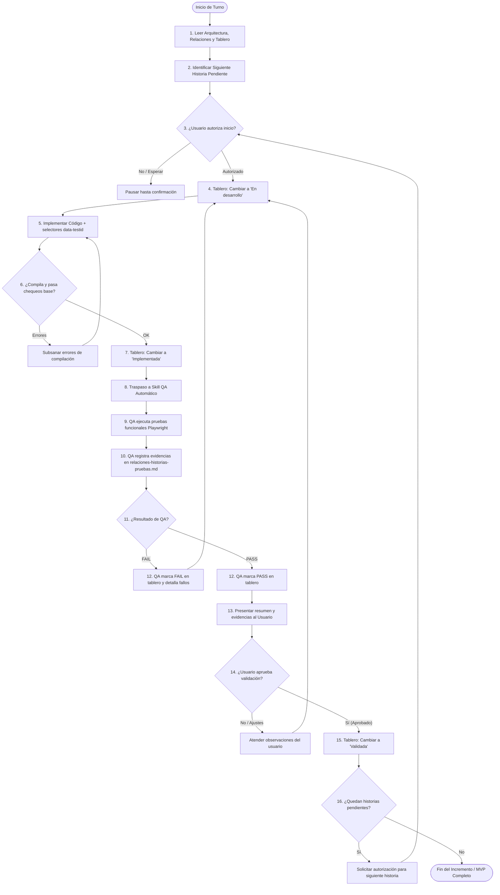

# Desarrollador de Historias de Usuario

Esta Skill rige el ciclo de desarrollo ordenado, incremental y disciplinado de software para **Mi Negocio Digital**. Garantiza que el código se construya estrictamente alineado a los requerimientos aprobados, incorporando los selectores `data-testid` requeridos para las pruebas automatizadas, coordinando el ciclo de validación con la Skill de **QA Automático** y manteniendo sincronizados únicamente los **tres artefactos oficiales**.

---

## 1. Reglas y Principios Obligatorios

1. **Gestión Exclusiva de Tres Artefactos**:
   - Todo el seguimiento técnico, funcional y de progreso se concentra exclusivamente en tres artefactos ubicados en `docs/`:
     - `docs/arquitectura.md`: Arquitectura, decisiones técnicas, stack tecnológico y estructura de datos.
     - `docs/relaciones-historias-pruebas.md`: Mapeo detallado de historias, criterios de aceptación BDD, selectores `data-testid`, casos de prueba y evidencias de ejecución.
     - `docs/tablero-historias.md`: Tablero de control centralizado con estado de desarrollo, pruebas funcionales, resultado PASS/FAIL y aprobación humana.
   - **Queda prohibido crear matrices duplicadas o documentos redundantes** (ej. matrices de trazabilidad paralelas o archivos dispersos de progreso).
   - Los cinco documentos de planificación aprobados (`01` a `05`) y el `documento-maestro.md` son inmutables y constituyen la fuente de verdad de requerimientos.

2. **Una Sola Historia a la Vez**:
   - Nunca implementar o mezclar dos o más historias de forma simultánea.
   - Todo el foco se mantiene en la historia activa hasta que sea formalmente validada por el usuario.

3. **Cero Invención y Cumplimiento Estricto de Criterios**:
   - Respetar rigurosamente los criterios de aceptación BDD (*Dado / Cuando / Entonces*) estipulados en `docs/relaciones-historias-pruebas.md`.
   - Incorporar de forma obligatoria en la UI los selectores `data-testid` indicados en cada criterio para asegurar la automatización de pruebas sin fragilidad.
   - Si falta información de contexto o reglas no contempladas, **detenerse y formular preguntas claras al usuario**. No asumir ni inventar requerimientos.

4. **Sinergia y Separación de Responsabilidades con QA Automático**:
   - **Desarrollador de Historias**: Es responsable de codificar la solución, asegurar la consistencia arquitectónica, incorporar selectores `data-testid`, verificar la compilación técnica y cambiar el estado a `Implementada`.
   - **QA Automático (futura Skill)**: Es responsable de ejecutar las pruebas funcionales E2E (Playwright) asociadas a la historia, registrar los resultados (`PASS` / `FAIL`) y documentar las evidencias técnicas en `docs/relaciones-historias-pruebas.md` y `docs/tablero-historias.md`.
   - **Ciclo Acotado de Corrección ante Fallos (Hasta 3 intentos)**:
     - Si QA marca `FAIL`, el Desarrollador retoma la historia regresando a `En desarrollo`.
     - Aplica correcciones acotadas exclusivamente al alcance de la historia de usuario en curso.
     - Se permite un máximo de hasta 3 intentos de corrección. Si el fallo persiste al 3er intento, se detiene el ciclo automático, se conserva el estado `FAIL` en el tablero y se escala al usuario para intervención humana.
     - **Nunca modificar criterios de aceptación ni relajar requerimientos para conseguir un PASS.**

5. **Sincronización Inmediata del Tablero Central**:
   - El estado de la historia en `docs/tablero-historias.md` transita ordenadamente:
     - `Pendiente` → `En desarrollo` → `Implementada` → (Evaluación QA: `PASS` / `FAIL`) → `Validada` (Aprobación humana).
   - Cualquier cambio de estado, resultado de prueba o visto bueno humano debe reflejarse inmediatamente en el tablero.

6. **Control Humano Irrenunciable para la Aprobación Final**:
   - **Ni el Desarrollador ni QA marcan una historia como `Validada` por cuenta propia.**
   - Una historia pasa a estado `Validada` **únicamente** cuando:
     1. El desarrollo está completo (`Implementada`).
     2. Las pruebas funcionales de QA han obtenido resultado `PASS`.
     3. El usuario humano evalúa los resultados y otorga su aprobación explícita en el chat.

7. **Autorización Previa para la Siguiente Historia**:
   - Tras validar una historia, el agente debe presentar el estado actualizado del tablero y solicitar autorización explícita al usuario antes de iniciar la siguiente historia pendiente.

---

## 2. Flujo de Trabajo Secuencial con QA Automático

---

## 3. Guía Operativa Paso a Paso

### Paso 1: Selección y Solicitud de Inicio
- Consultar `docs/tablero-historias.md` y `docs/relaciones-historias-pruebas.md`.
- Identificar la siguiente historia en estado `Pendiente` respetando la prioridad y dependencias técnicas (ej. HU-01 configuración antes de HU-04 agendamiento).
- Formular la solicitud al usuario:
  > *«La siguiente historia en el tablero es **HU-XX: [Título]**. ¿Deseas autorizar el inicio de su desarrollo?»*

### Paso 2: Transición a "En desarrollo"
- Tras recibir la autorización del usuario:
  - Actualizar `docs/tablero-historias.md`: cambiar columna *Estado de Desarrollo* a `En desarrollo`.
  - Registrar en la bitácora del tablero la fecha y cambio.

### Paso 3: Codificación Alineada a Criterios y `data-testid`
- Leer en detalle los criterios de aceptación y selectores de la historia en `docs/relaciones-historias-pruebas.md`.
- Consultar las directrices de `docs/arquitectura.md` (Next.js, TypeScript, Tailwind CSS, Prisma, SQLite, Zod).
- Implementar la funcionalidad asegurando que cada elemento interactivo o de verificación cuente exactamente con su atributo `data-testid` correspondiente.
- No construir código perteneciente a historias futuras ni añadir funcionalidades fuera de alcance.

### Paso 4: Pre-verificación Técnica y Pase a "Implementada"
- Verificar que el proyecto compile sin errores de tipos ni sintaxis (`npm run build` o `npx tsc`).
- Actualizar `docs/tablero-historias.md`: cambiar *Estado de Desarrollo* a `Implementada`.
- En la columna *Pruebas Funcionales*, indicar las suites o casos de prueba listos para ejecución (ej. `TC-HU01-01, TC-HU01-02`).

### Paso 5: Traspaso a la Skill QA Automático
- Notificar que la historia está lista para la ejecución de pruebas funcionales automatizadas.
- La Skill de QA ejecutará los tests pertinentes basados en `docs/relaciones-historias-pruebas.md`.

### Paso 6: Manejo del Resultado de QA y Ciclo de Corrección
- **Si QA registra `FAIL`**:
  - `docs/tablero-historias.md` reflejará `FAIL` en *Resultado*.
  - Revisar el informe de error registrado por QA en `docs/relaciones-historias-pruebas.md`.
  - Revertir el estado a `En desarrollo` en el tablero y aplicar las correcciones necesarias estrictamente dentro del alcance de la HU (máximo 3 intentos).
  - Si se agotan los 3 intentos sin éxito, detener el ciclo automático y solicitar intervención humana.
- **Si QA registra `PASS`**:
  - `docs/tablero-historias.md` reflejará `PASS` en *Resultado*.
  - La historia queda expedita para revisión del usuario.

### Paso 7: Presentación al Usuario y Aprobación Humana
- Presentar un informe conciso al usuario:
  1. Resumen de lo construido.
  2. Confirmación de `PASS` otorgado por QA Automático y enlace a las evidencias en `docs/relaciones-historias-pruebas.md`.
  3. Pregunta de cierre obligatoria:
     > *«Las pruebas funcionales automatizadas de la historia **HU-XX** han resultado en **PASS**. ¿Apruebas el resultado para marcarla formalmente como **Validada**?»*

### Paso 8: Cierre y Transición
- Si el usuario aprueba:
  - Actualizar `docs/tablero-historias.md`: cambiar *Estado de Desarrollo* a `Validada` y *Aprobación Humana* a `Aprobada por Humano`.
  - Actualizar el porcentaje de avance general en el tablero.
  - Solicitar autorización para la siguiente historia.
- Si el usuario solicita ajustes o rechaza:
  - Registrar las observaciones, retornar a `En desarrollo` y corregir.

---

## 4. Protocolo de Actualización de Artefactos por QA Automático

Para garantizar perfecta interoperabilidad sin conflictos ni duplicidad, la futura Skill `qa-automatico` operará bajo las siguientes reglas en los mismos artefactos:

1. **En `docs/relaciones-historias-pruebas.md`**:
   - Localiza la sección de la historia bajo prueba.
   - En cada caso de prueba (`TC-HUXX-YY`), actualiza:
     - **Estado**: Cambia de `[Pendiente]` a `[PASS]` o `[FAIL]`.
     - **Fecha/Hora de Ejecución**: Timestamp de la corrida.
     - **Evidencia Técnica**: Inserta log resumido de consola de Playwright, duración del test y ruta a captura de pantalla (screenshot) o traza en caso de fallo.
2. **En `docs/tablero-historias.md`**:
   - En la fila de la historia correspondiente:
     - Actualiza la columna **Resultado PASS/FAIL**: Asigna `PASS` si todos los casos de prueba superaron la verificación, o `FAIL` si al menos uno falló.
     - Actualiza la columna **Pruebas Funcionales**: Indica la cantidad de tests aprobados (ej. `2/2 superados`).
   - Añade una entrada en la **Bitácora de Eventos** indicando la corrida de QA y el resultado.
3. **Restricción de QA**:
   - La Skill de QA **NUNCA** modifica la columna *Aprobación Humana* ni el archivo `docs/arquitectura.md`.
