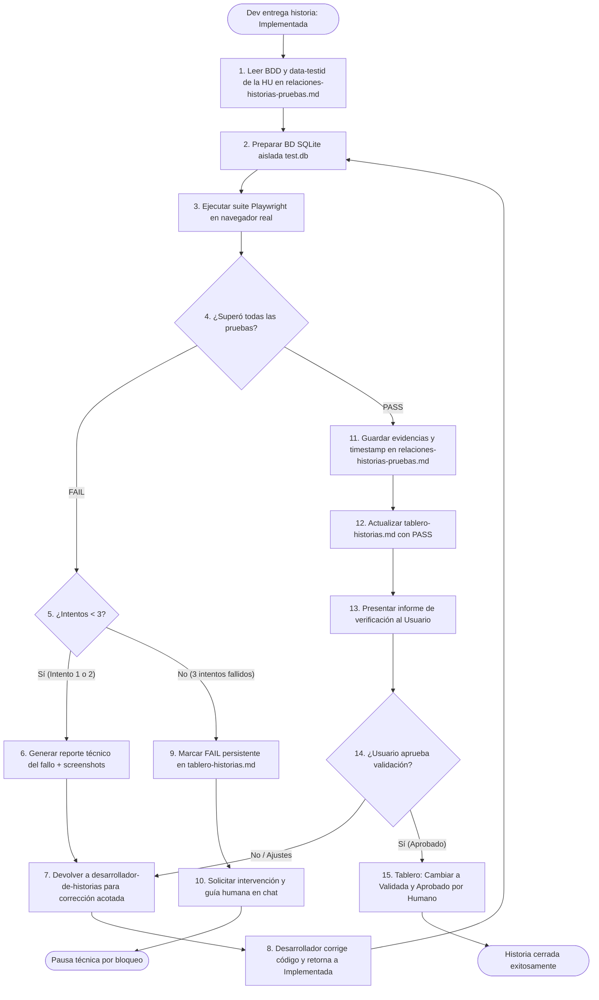

# QA Automático (Aseguramiento de Calidad)

Esta Skill rige el aseguramiento riguroso de la calidad del software para **Mi Negocio Digital**. Es responsable de verificar que el código implementado satisfaga de forma fidedigna cada Criterio de Aceptación mediante pruebas automatizadas de integración y E2E en navegadores reales utilizando **Playwright**, ejecutando en un entorno de pruebas aislado con **SQLite**, recopilando evidencias reproducibles y sincronizando el estado con la Skill **desarrollador-de-historias** y el usuario humano.

---

## 1. Principios y Reglas Innegociables

1. **Cero Alteración de Criterios de Aceptación**:
   - **NUNCA modificar, relajar, omitir o acomodar un criterio de aceptación BDD ni un selector `data-testid` para obtener un `PASS`.**
   - Si una prueba falla porque la funcionalidad no se ajusta al requerimiento, el código bajo prueba debe ser corregido, jamás la especificación del requerimiento ni la aserción de prueba.

2. **Entorno de Pruebas Aislado con SQLite**:
   - Las pruebas E2E deben ejecutarse siempre contra una base de datos SQLite aislada (`prisma/test.db` o entorno configurado vía variables de test).
   - Se debe garantizar el reseteo o estado limpio de los datos antes de cada corrida de prueba para asegurar determinismo, repetibilidad e idempotencia sin contaminar los datos del entorno de desarrollo.

3. **Uso Exclusivo de Selectores `data-testid`**:
   - Toda interacción y aserción en Playwright debe realizarse mediante localizadores resistentes a cambios de interfaz:
     - `page.getByTestId('selector')` o `locator('[data-testid="selector"]')`.
   - Se prohíbe localizar elementos por clases CSS dinámicas, selectores frágiles de Tailwind o texto volátil susceptible a traducciones o variaciones de diseño.

4. **Ejecución en Navegadores Reales con Playwright**:
   - Las pruebas se ejecutan contra navegadores reales (Chromium / WebKit / Firefox) sobre el servidor local de la aplicación en ejecución.
   - Deben capturarse interacciones reales: navegación de rutas, envío de Server Actions, diálogos modales, validaciones de formularios y mensajes de notificación (toast/alert).

5. **Ciclo Acotado de Corrección (Hasta 3 Intentos)**:
   - Ante un fallo (`FAIL`), QA analiza el origen del error, compila las evidencias (log, screenshot, traza) y las transmite con precisión a `desarrollador-de-historias`.
   - La corrección debe limitarse estrictamente al **alcance específico de la Historia de Usuario activa**.
   - Se autorizan **hasta tres (3) ciclos de corrección** (Intento 1 → Intento 2 → Intento 3).
   - Si tras el 3er intento de corrección el fallo persiste, QA detiene el ciclo automático, fija el resultado como `FAIL` en el tablero y solicita formalmente la **intervención humana**.

6. **Gestión Rigurosa de Evidencias**:
   - Toda ejecución debe documentar:
     - Fecha y hora exacta de ejecución (timestamp ISO).
     - Duración total de la suite de pruebas.
     - Registro resumido de consola de Playwright (número de tests pasados/fallados).
     - Captura de pantalla (`screenshot`) en el punto exacto de la falla o archivo de traza (`trace.zip`).

7. **Actualización Exclusiva de Dos Artefactos**:
   - La Skill de QA solo actualiza:
     - `docs/relaciones-historias-pruebas.md`: Estado de cada caso (`TC-HUXX-YY`), marcas de tiempo y bloque de evidencias técnicas.
     - `docs/tablero-historias.md`: Columna *Pruebas Funcionales* y *Resultado PASS/FAIL*.
   - **Queda terminantemente prohibido modificar `docs/arquitectura.md` o los documentos de planificación (`01` a `05`).**
   - No se crean matrices secundarias ni documentos de reporte redundantes.

8. **Control Humano Irrenunciable para la Validación**:
   - **QA NUNCA marca una historia como `Validada`.**
   - El veredicto técnico de QA es únicamente `PASS` o `FAIL`.
   - La transición a `Validada` en el tablero es potestad exclusiva del usuario humano tras revisar las evidencias y otorgar su visto bueno explícito en el chat.

9. **Una Sola Historia a la Vez**:
   - Se verifica y atiende una única historia en curso hasta su conclusión.

---

## 2. Flujo de Trabajo: Desarrollo → QA → Corrección → Aprobación



---

## 3. Guía Operativa Paso a Paso

### Paso 1: Recepción de la Historia
- Confirmar que en `docs/tablero-historias.md` la historia se encuentra en estado `Implementada`.
- Leer los criterios BDD, selectores y casos asignados en `docs/relaciones-historias-pruebas.md`.

### Paso 2: Preparación del Entorno Aislado
- Comprobar que las variables de entorno de prueba apunten a la base de datos de test (ej. `DATABASE_URL="file:./test.db"`).
- Ejecutar el reseteo/migración limpia del esquema en la base de datos de test (`npm run test:e2e:setup` o script de aislamiento).
- Asegurar que el servidor local de desarrollo o build de prueba esté levantado y receptivo en el puerto configurado (ej. `http://localhost:3000`).

### Paso 3: Ejecución de Pruebas E2E en Playwright
- Ejecutar la suite correspondiente a la historia:
  ```bash
  npx playwright test e2e/hu-XX-*.spec.ts
  ```
- Playwright interactuará con el navegador real simulando la conducta del usuario final sobre los selectores `data-testid`.

### Paso 4: Tratamiento de Fallos y Ciclo de Corrección (Hasta 3 Intentos)
- Si una o más aserciones fallan:
  - Incrementar el contador de intentos para la historia (1/3, 2/3, 3/3).
  - Extraer del reporte:
    1. Caso específico que falló (`TC-HUXX-YY`).
    2. Línea de código del test y aserción incumplida.
    3. Diferencia entre el valor esperado (*expected*) y el valor recibido (*received*).
    4. Ruta de la captura de pantalla o traza generada en `test-results/`.
  - **Si intentos < 3**:
    - Comunicar el reporte al `desarrollador-de-historias`.
    - Indicar que la corrección debe limitarse estrictamente a subsanar el fallo sin tocar código ajeno a la HU.
    - Esperar a que el desarrollador aplique los ajustes y confirme nuevamente el estado `Implementada`.
    - Re-ejecutar el Paso 2 y 3.
  - **Si intentos == 3 y el fallo persiste**:
    - Actualizar `docs/tablero-historias.md` fijando *Resultado PASS/FAIL* en `FAIL`.
    - Registrar el detalle en la bitácora del tablero.
    - Emitir mensaje de alerta al usuario humano explicando el problema recurrente y solicitando instrucciones.

### Paso 5: Registro de Evidencias ante Éxito (`PASS`)
- Cuando el 100% de los casos de la historia resulten exitosos:
  - En `docs/relaciones-historias-pruebas.md`:
    - Cambiar cada `TC-HUXX-YY` a `Estado: [PASS]` y `Resultado: [Aprobado]`.
    - Rellenar la sección `Evidencias de QA` con la fecha, duración y log resumido de Playwright.
  - En `docs/tablero-historias.md`:
    - Actualizar *Pruebas Funcionales* indicando los casos superados (ej. `2/2 superados`).
    - Cambiar *Resultado PASS/FAIL* a `PASS`.
    - Agregar entrada en la *Bitácora de Eventos*.

### Paso 6: Presentación al Usuario Humano
- Informar en el chat:
  > *«La suite de pruebas automatizadas con Playwright para la historia **HU-XX: [Título]** ha finalizado con resultado **PASS** (X/X casos verificados). Las evidencias se encuentran registradas en `docs/relaciones-historias-pruebas.md` y `docs/tablero-historias.md`. ¿Autorizas la validación final para marcar la historia como **Validada**?»*

---

## 4. Estándar de Código para Pruebas Playwright

Cada archivo de prueba en `e2e/` debe estructurarse conforme a este patrón:

```typescript
import { test, expect } from '@playwright/test';

test.describe('HU-XX: [Título de la Historia]', () => {
  test.beforeEach(async ({ page }) => {
    // 1. Navegación a la vista requerida
    await page.goto('/ruta');
  });

  test('TC-HUXX-01: [Nombre del Escenario BDD]', async ({ page }) => {
    // DADO / CUANDO
    await page.getByTestId('input-ejemplo').fill('Dato de prueba');
    await page.getByTestId('btn-accion').click();

    // ENTONCES
    await expect(page.getByTestId('toast-success')).toBeVisible();
    await expect(page.getByTestId('elemento-resultado')).toContainText('Dato esperado');
  });
});
```
