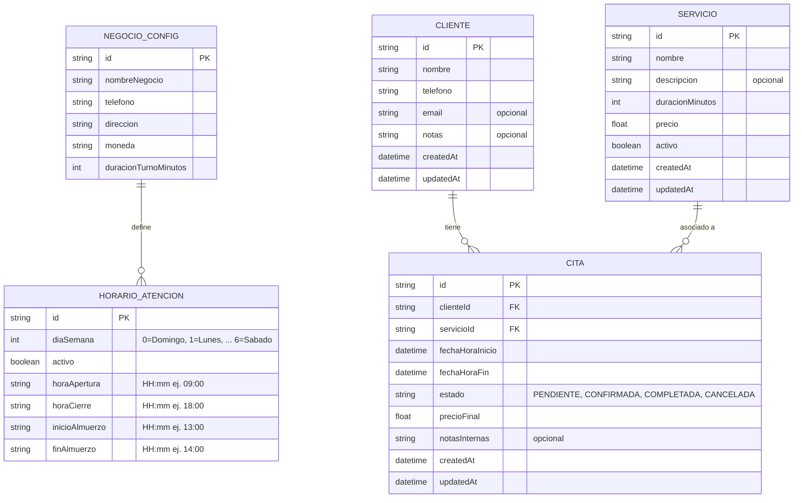

# 04 - Datos y Tecnología

## 1. Modelo Conceptual de Datos (Entidades Clave)

El sistema se estructura en torno a cinco entidades principales interconectadas:



### Descripción Detallada de Entidades y Relaciones:
1. **NegocioConfig**:
   - Almacena los parámetros generales de la empresa (nombre, contacto, moneda y configuración global de turnos). Existe un único registro global.
2. **HorarioAtencion**:
   - Modela la disponibilidad de cada día de la semana (del 0 al 6). Permite activar/desactivar días completos y fijar horas de inicio/fin y receso de comida.
3. **Cliente**:
   - Registro de contactos del negocio. Se relaciona de 1 a N con **Cita** (un cliente puede tener múltiples citas a lo largo del tiempo).
4. **Servicio**:
   - Catálogo de prestaciones con duración en minutos (utilizada para calcular dinámicamente `fechaHoraFin`) y precio de lista. Se relaciona de 1 a N con **Cita**.
5. **Cita**:
   - La entidad operativa medular. Vincula un `Cliente` con un `Servicio` en un intervalo de tiempo específico (`fechaHoraInicio` a `fechaHoraFin`).
   - Almacena el `estado` (*PENDIENTE*, *CONFIRMADA*, *COMPLETADA*, *CANCELADA*) y el `precioFinal` cobrado o acordado.

---

## 2. Pila Tecnológica Seleccionada (Tech Stack)

| Capa | Tecnología | Justificación y Ventajas |
| :--- | :--- | :--- |
| **Framework Full-Stack** | **Next.js (App Router, React, Server Actions)** | Combina interfaz de usuario y lógica de servidor en un solo proyecto cohesivo. Los *Server Actions* eliminan la necesidad de escribir una API REST tradicional separada, acelerando el desarrollo y reduciendo el código repetitivo. |
| **Lenguaje de Programación** | **TypeScript** | Proporciona tipado estático riguroso de extremo a extremo (desde los modelos de Prisma hasta los componentes visuales de React). Evita errores en tiempo de ejecución al validar tipos de datos de fechas, precios e identificadores. |
| **Estilos y Diseño Visual** | **Tailwind CSS** | Permite crear una interfaz limpia, profesional y totalmente responsiva de forma ágil mediante clases utilitarias, sin archivos CSS externos desordenados ni librerías pesadas que ralenticen la carga. |
| **Iconografía** | **Lucide Icons** | Conjunto de iconos ligeros, modernos y consistentes para acciones de calendario, clientes, llamadas y estados. |
| **Base de Datos** | **SQLite (archivo local)** | Base de datos embebida en un único archivo (`dev.db`). No requiere instalar servidores pesados (como MySQL o PostgreSQL), consume mínimos recursos de CPU/RAM y facilita respaldos instantáneos simplemente copiando el archivo. |
| **ORM / Acceso a Datos** | **Prisma ORM** | Genera un cliente fuertemente tipado a partir de un esquema declarativo (`schema.prisma`). Gestiona migraciones de base de datos de manera automática y previene inyecciones SQL de forma nativa. |
| **Validación de Datos** | **Zod** | Librería estándar para validación de esquemas tanto en formularios de cliente como en mutaciones de servidor. |
| **Testing Automatizado** | **Playwright** | Framework de pruebas de integración y extremo a extremo (E2E) de alta fiabilidad. Permite simular interacciones reales de usuario en navegadores (Chromium, Firefox, WebKit) y validar la ausencia de conflictos de horarios. |

---

## 3. Arquitectura del Sistema e Integraciones

```
┌────────────────────────────────────────────────────────┐
│                   Navegador del Usuario                │
│    (Desktop, Tablet o Smartphone - Interfaz Web)       │
└───────────────────────────▲────────────────────────────┘
                            │ HTTP / React Server Actions
┌───────────────────────────▼────────────────────────────┐
│                  Next.js Application                   │
│   ├── UI Components (Tailwind CSS + Lucide Icons)      │
│   ├── Server Actions & Rutas de Validación (Zod)       │
│   └── Lógica de Negocio: Detector de Solapamientos     │
└───────────────────────────▲────────────────────────────┘
                            │ Consultas Tipadas
┌───────────────────────────▼────────────────────────────┐
│                       Prisma ORM                       │
└───────────────────────────▲────────────────────────────┘
                            │ Lectura / Escritura
┌───────────────────────────▼────────────────────────────┐
│             SQLite Database (Archivo .db)              │
│       Almacenamiento Local Autónomo y Seguro           │
└────────────────────────────────────────────────────────┘
```

### Integraciones Externas y Despliegue:
- **Cero Dependencias Externas en MVP**: No se integran servicios cloud de terceros para autenticación ni almacenamiento. Todo corre localmente en el propio host.
- **Acceso y Autenticación**:
  - *Desarrollo Local*: Acceso directo sin autenticación para agilidad máxima de desarrollo y pruebas.
  - *Despliegue Público (AWS Lightsail)*: Obligatoriedad de habilitar capa de autenticación antes de la exposición pública para resguardo de información privada.
- **Preparación para Repositorio GitHub**:
  - Estructura limpia con archivo `.gitignore` estandarizado que excluye la base de datos local de desarrollo (`*.db`, `*.db-journal`), variables de entorno (`.env`) y la carpeta `node_modules/`.
  - Scripts en `package.json` para linting, construcción y ejecución de tests con Playwright.
- **Despliegue Opcional en AWS Lightsail**:
  - Preparado para desplegarse mediante un contenedor Docker ligero o directamente como proceso Node.js gestionado con `PM2` detrás de un proxy inverso Nginx en una instancia VPS económica de Lightsail.
