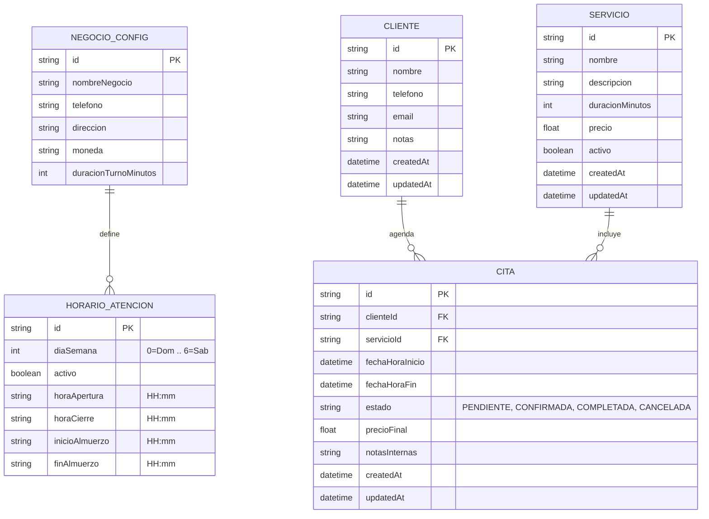

# Arquitectura y Decisiones Técnicas

> **Proyecto**: Mi Negocio Digital  
> **Artefacto**: 1 de 3 (Arquitectura y Decisiones Técnicas)  
> **Estado**: MVP 100% Completado y Validado Formalmente por Humano (8/8 historias validadas - 20/20 pruebas en PASS con ampliaciones en HU-02 y HU-06/07)  
> **Puertos y Bases de Datos**: Desarrollo en localhost:3000 (`prisma/dev.db`) | Pruebas E2E en localhost:3001 (`prisma/test.db`)  
> **Última Actualización**: 21 de Noviembre de 2026  

---

## 1. Visión General del Sistema

**Mi Negocio Digital** es una aplicación web full-stack ágil, autónoma y monolítica, diseñada para que profesionales independientes y pequeños comercios gestionen de forma centralizada sus clientes, catálogo de servicios, horarios laborales y programación de citas, eliminando colisiones y solapamientos de turnos.

El MVP opera en un entorno **estrictamente administrativo y local**, sin dependencias de servicios en la nube para autenticación o persistencia, garantizando soberanía total sobre los datos mediante una base de datos SQLite embebida.

---

## 2. Pila Tecnológica (Tech Stack)

| Capa / Función | Tecnología | Justificación y Rol en el Sistema |
| :--- | :--- | :--- |
| **Framework Full-Stack** | **Next.js (App Router, React)** | Proporciona una arquitectura unificada de cliente y servidor. Emplea *React Server Components* para renderizado óptimo y *Server Actions* para mutaciones directas. |
| **Lenguaje** | **TypeScript** | Tipado estático riguroso de extremo a extremo (esquema Prisma, validaciones Zod, Server Actions y componentes React). |
| **Estilos y UI** | **Tailwind CSS + Lucide Icons** | Diseño responsivo y modular basado en clases utilitarias; iconografía limpia sin sobrecarga de dependencias. |
| **Base de Datos** | **SQLite (archivo local `dev.db`)** | Motor de base de datos embebido en archivo local. Cero configuración de infraestructura, mínimo consumo de memoria y portabilidad total. |
| **ORM / Acceso a Datos** | **Prisma ORM** | Capa de abstracción tipada que gestiona migraciones declarativas y consultas SQL seguras contra inyecciones. |
| **Validación de Datos** | **Zod** | Esquemas de validación compartidos para formularios de cliente y validaciones estrictas en el servidor. |
| **QA y Pruebas Automatizadas**| **Playwright** | Automatización de pruebas funcionales y de integración E2E navegando en Chromium/Firefox/WebKit contra los selectores `data-testid`. |

---

## 3. Decisiones Técnicas Clave

### D1: Mutaciones Mediante Server Actions
Se descarta la creación de una API REST tradicional o endpoints API redundantes (`/api/...`). Todas las operaciones de mutación de base de datos (creación, edición, eliminación y cambio de estados) se ejecutan a través de **Next.js Server Actions**, simplificando el flujo de datos y asegurando validación inmediata en el servidor con Zod.

### D2: Autonomía Local y Soberanía de Datos
Para el MVP, la aplicación no depende de ningún servicio SaaS externo (sin Firebase, sin Supabase, sin Auth0, sin buckets S3). Todos los datos se almacenan en un archivo SQLite local (`prisma/dev.db`). El acceso en desarrollo es directo para optimizar la velocidad de iteración y testing.

### D3: Motor Anticolisiones y Flexibilidad de Adyacencia
El algoritmo de validación de horarios implementa dos reglas indispensables:
1. **Prevención de Solapamiento**: Ninguna cita puede intersectar con otra cita activa (estados `PENDIENTE` o `CONFIRMADA`).
2. **Adyacencia Continua Sin Buffer Obligatorio**: Se permite explícitamente que una cita inicie exactamente en el minuto en que finaliza la anterior (ej. Cita A de 10:00 a 10:45 y Cita B de 10:45 a 11:30 son válidas y contiguas).
3. **Respeto a Horarios Laborales y Recesos**: Toda cita debe iniciar y terminar dentro del horario hábil del día configurado, y no puede solapar con el intervalo de receso (almuerzo).

### D4: Estandarización de Selectores `data-testid`
Para desacoplar el desarrollo de la interfaz de la automatización de pruebas, todos los elementos interactivos, campos de formulario, botones de acción, insignias de estado y contenedores clave deben contener atributos `data-testid` explícitos (según lo definido en `docs/relaciones-historias-pruebas.md`). Esto permite que la futura Skill de QA ejecute Playwright sin fragilidad ante cambios de clases o diseño visual.

### D5: Ciclo de Vida y Mutaciones del Catálogo de Servicios (HU-02)
El catálogo de servicios implementa un ciclo de vida completo mediante Server Actions tipados y validados con Zod (`ServiceSchema`):
- **Alta (`createService`)**: Registro de nuevos servicios con validación de nombre, duración mínima y precio base no negativo.
- **Edición (`updateService`)**: Modificación reactiva de servicios existentes conservando su identificador y relaciones de citas previas. Los campos (nombre, descripción, duración, precio) se precargan en el modal con data-testid `btn-edit-service`.
- **Conmutación de Estado (`toggleServiceStatus`)**: Activación y desactivación lógica que preserva el histórico de citas existentes mientras controla la disponibilidad en el agendamiento.
- **Eliminación Definitiva y Control de Integridad (`deleteService`)**: Eliminación física del registro exclusivamente cuando no posee citas vinculadas (`_count.citas === 0`). En caso de existir historial de citas, el sistema bloquea la operación y orienta al usuario hacia la desactivación lógica para preservar la integridad referencial y el histórico operativo.
- **Revalidación de Caché**: Cada mutación invoca `revalidatePath('/servicios')` para refrescar instantáneamente la vista sin recarga manual.

### D6: Gestión Integral del Ciclo de Vida y Reprogramación de Citas en Agenda (HU-06 y HU-07)
La interfaz de agenda (`/citas`) integra la gestión de citas mediante botones de acción inmediata y un diálogo modal centralizado (`btn-manage-appointment` / `modal-manage-appointment`):
- **Citas Pendientes**: Permite confirmación directa (`btn-status-confirmed` o `modal-btn-confirm`), reprogramación de fecha/hora o cancelación con liberación de cupo.
- **Citas Confirmadas**: Permite marcar como completada (`btn-status-completed`), reprogramación o cancelación.
- **Citas Completadas**: Estado terminal; la interfaz y el servidor (`updateAppointmentStatus`, `rescheduleAppointment`) protegen el registro contra alteraciones para preservar el historial.
- **Citas Canceladas**: Estado terminal; el cupo en agenda queda liberado y el sistema impide reactivación o reprogramación.

---

## 4. Modelo de Datos y Entidades (Prisma Schema)



---

## 5. Estructura de Proyecto Prevista

```text
mi-negocio-digital/
├── docs/                                  # Documentación oficial del proyecto
│   ├── 01-nucleo-y-mvp.md                 # Fase 1 (Aprobada)
│   ├── 02-experiencia-usuario-ux.md       # Fase 2 (Aprobada)
│   ├── 03-requisitos-de-calidad.md        # Fase 3 (Aprobada)
│   ├── 04-datos-y-tecnologia.md           # Fase 4 (Aprobada)
│   ├── 05-historias-de-usuario.md         # Fase 5 (Aprobada)
│   ├── documento-maestro.md               # Resumen ejecutivo consolidado
│   ├── arquitectura.md                    # [Artefacto 1] Arquitectura y decisiones técnicas
│   ├── relaciones-historias-pruebas.md    # [Artefacto 2] Trazabilidad HU - Pruebas - QA
│   └── tablero-historias.md               # [Artefacto 3] Seguimiento centralizado de estados
├── prisma/
│   ├── schema.prisma                      # Definición de modelos relacionales
│   └── seed.ts                            # Datos iniciales para pruebas
├── src/
│   ├── app/                               # Next.js App Router (Páginas y layouts)
│   │   ├── dashboard/                     # HU-08: Panel principal
│   │   ├── citas/                         # HU-04, HU-05, HU-06, HU-07: Agenda
│   │   ├── clientes/                      # HU-03: Directorio de clientes
│   │   ├── servicios/                     # HU-02: Catálogo de servicios
│   │   ├── horarios/                      # HU-01: Configuración de horarios
│   │   └── layout.tsx                     # Barra de navegación lateral común
│   ├── actions/                           # Next.js Server Actions tipados
│   ├── components/                        # Componentes UI reutilizables con data-testid
│   └── lib/                               # Instancia de Prisma, Zod schemas, utilidades
└── e2e/                                   # Suites de pruebas funcionales Playwright (QA)
    ├── hu-01-horarios.spec.ts
    ├── hu-02-servicios.spec.ts
    ├── hu-03-clientes.spec.ts
    ├── hu-04-agendamiento.spec.ts
    ├── hu-05-agenda-filtros.spec.ts
    ├── hu-06-ciclo-citas.spec.ts
    ├── hu-07-reprogramacion.spec.ts
    └── hu-08-dashboard.spec.ts
```

---

## 6. Directrices Técnicas de Interoperabilidad con QA

1. **Inyección de `data-testid`**:
   - Cada botón, entrada, modal, notificación (toast/alert) e indicador de estado debe contar obligatoriamente con el identificador exacto indicado en `docs/relaciones-historias-pruebas.md`.
2. **Determinismo en Base de Datos**:
   - Para las pruebas de Playwright ejecutadas por QA, la base de datos SQLite puede reiniciarse o utilizar un archivo específico de pruebas para garantizar repetibilidad sin colisiones de datos previos.
3. **Manejo de Tiempos y Fechas**:
   - La lógica de solapamiento y validación horaria se computa en fechas ISO estandarizadas UTC en base de datos, convirtiéndose a hora local en la capa de presentación.
