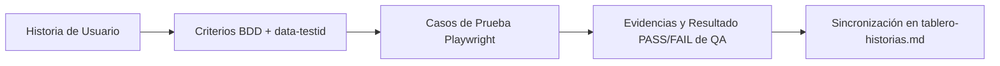

# Relaciones entre Historias de Usuario, Criterios de Aceptación y Pruebas

> **Proyecto**: Mi Negocio Digital  
> **Artefacto**: 2 de 3 (Trazabilidad HU - Criterios - Pruebas - QA)  
> **Estado**: Inicializado para Fase de Desarrollo y QA  
> **Última Actualización**: Noviembre 2026  

Este artefacto centraliza la trazabilidad funcional de las **ocho Historias de Usuario aprobadas**, detallando sus escenarios BDD (*Dado / Cuando / Entonces*), los selectores estandarizados `data-testid`, los casos de prueba funcionales automatizados y la sección de registro de evidencias para la futura Skill **qa-automatico**.

---

## Protocolo de Actualización para la Skill QA Automático

Cuando la Skill `qa-automatico` sea activada para validar una historia que se encuentra en estado `Implementada`, debe seguir este protocolo en el presente documento:
1. **Localizar el Caso de Prueba**: Ubicar la sección correspondiente a la historia (`HU-XX`) y el caso específico (`TC-HUXX-YY`).
2. **Actualizar el Estado del Caso**:
   - Cambiar `Estado: [Pendiente]` a `Estado: [PASS]` si todos los assertions del escenario se cumplen.
   - Cambiar `Estado: [Pendiente]` a `Estado: [FAIL]` si ocurre una aserción fallida, timeout o error no controlado.
3. **Documentar la Evidencia Técnica**:
   - En el bloque `### Evidencias de QA`, registrar:
     - Fecha y hora exacta de ejecución (timestamp).
     - Duración de la prueba (ms / s).
     - Extracto del log de consola de Playwright.
     - Enlace o ruta de la captura de pantalla (`screenshot`) o reporte de traza (`trace.zip`) en caso de fallo.
4. **Ciclo Acotado de Corrección ante Fallos**:
   - Se gestionan hasta 3 intentos de corrección con el desarrollador, exclusivamente acotados a la historia en curso.
   - Si al 3er intento el error persiste, se fija `FAIL` y se solicita intervención humana.
   - **Regla Innegociable**: Nunca modificar criterios BDD ni relajar aserciones para forzar un `PASS`.
5. **Sincronización**: Reflejar el resultado global (`PASS` o `FAIL`) en `docs/tablero-historias.md`.

---

## Matriz de Trazabilidad por Historia de Usuario



---

### HU-01: Configuración de Datos del Negocio y Horarios de Atención

- **Módulo**: Configuración / Horarios
- **Prioridad**: Must have
- **Estado de Validación**: **VALIDADA** (Aprobación humana formal confirmada el 2026-11-21)
- **Historia**: Como administrador del negocio, quiero registrar los datos de mi empresa y definir los días y horas en que presto servicios, para que las citas solo puedan agendarse en mis horarios laborales reales.
- **Suite de Pruebas**: `e2e/hu-01-horarios.spec.ts`
- **Servidor de Test**: `http://localhost:3001` (Aislado de desarrollo en puerto 3000)
- **Base de Datos de Test**: `prisma/test.db` (Aislada de `prisma/dev.db`)

#### Criterios de Aceptación y Casos de Prueba

| ID Caso | Escenario BDD | Selectores `data-testid` Clave | Estado QA | Resultado |
| :--- | :--- | :--- | :---: | :---: |
| **TC-HU01-01** | **Configurar horario laboral con almuerzo**:<br>**Dado** que el usuario ingresa a `/horarios`,<br>**Cuando** activa el lunes (`toggle-day-1`), define apertura "09:00" (`input-open-1`), cierre "18:00" (`input-close-1`), receso de "13:00" a "14:00" (`input-lunch-start-1`, `input-lunch-end-1`) y pulsa "Guardar" (`btn-save-schedule`),<br>**Entonces** se guarda la configuración y muestra mensaje de éxito (`toast-success`). | `toggle-day-1`<br>`input-open-1`<br>`input-close-1`<br>`input-lunch-start-1`<br>`input-lunch-end-1`<br>`btn-save-schedule`<br>`toast-success` | `PASS` | `Aprobado` |
| **TC-HU01-02** | **Validación de hora de cierre previa a apertura**:<br>**Dado** que el usuario configura apertura "18:00" y cierre "09:00",<br>**Cuando** pulsa "Guardar Horarios",<br>**Entonces** el sistema bloquea el guardado y muestra advertencia (`alert-error-schedule`). | `input-open-1`<br>`input-close-1`<br>`btn-save-schedule`<br>`alert-error-schedule` | `PASS` | `Aprobado` |

#### Evidencias de QA (Registrado por Skill qa-automatico)
- **Fecha de Corrida**: 2026-11-21T17:30:21-05:00
- **Modo de Ejecución**: Visible en escritorio (`headless: false`, `slowMo: 500ms`, `workers: 1`) sobre Chromium para grabación de pantalla.
- **Entorno de Datos**: Aislado sobre `prisma/prisma/test.db` (sin afectar `dev.db`).
- **Ciclo de Corrección**: 1 iteración (ajuste de aserción de carga en hook beforeEach sin alterar criterios de aceptación BDD).
- **Log de Playwright**:
  ```text
  Running 2 tests using 1 worker
    ok 1 [chromium] › e2e\hu-01-horarios.spec.ts:13:3 › HU-01: Configuración de Datos del Negocio y Horarios de Atención › TC-HU01-01: Configurar horario laboral con receso de almuerzo (5.6s)
    ok 2 [chromium] › e2e\hu-01-horarios.spec.ts:47:3 › HU-01: Configuración de Datos del Negocio y Horarios de Atención › TC-HU01-02: Validación de hora de cierre previa a hora de apertura (3.8s)

    2 passed (19.4s)
  ```
- **Capturas / Trazas**: Ejecución 100% exitosa (`PASS`). Trazas y videos generados en `test-results/`.

---

### HU-02: Gestión del Catálogo de Servicios

- **Módulo**: Servicios
- **Prioridad**: Must have
- **Estado de Validación**: **VALIDADA** (Aprobación humana formal confirmada el 2026-11-21)
- **Historia**: Como profesional, quiero dar de alta, editar y listar mis servicios con su duración y tarifa, para que al agendar una cita el sistema calcule automáticamente el tiempo y costo correspondiente.
- **Suite de Pruebas**: `e2e/hu-02-servicios.spec.ts`
- **Servidor de Test**: `http://localhost:3001` (Aislado de desarrollo)
- **Base de Datos de Test**: `prisma/test.db` (Aislada de `prisma/dev.db`)

#### Criterios de Aceptación y Casos de Prueba

| ID Caso | Escenario BDD | Selectores `data-testid` Clave | Estado QA | Resultado |
| :--- | :--- | :--- | :---: | :---: |
| **TC-HU02-01** | **Creación exitosa de nuevo servicio**:<br>**Dado** que el usuario está en `/servicios`,<br>**Cuando** hace clic en "Nuevo Servicio" (`btn-new-service`), completa "Consulta General" (`input-service-name`), duración "45" (`input-service-duration`), precio "35.00" (`input-service-price`) y pulsa "Guardar" (`btn-save-service`),<br>**Entonces** el modal se cierra y la lista muestra una tarjeta con "Consulta General" y "$35.00" (`service-card-item`). | `btn-new-service`<br>`input-service-name`<br>`input-service-duration`<br>`input-service-price`<br>`btn-save-service`<br>`service-card-item` | `PASS` | `Aprobado` |
| **TC-HU02-02** | **Desactivación temporal de servicio**:<br>**Dado** un servicio existente en la lista,<br>**Cuando** el usuario pulsa en el interruptor de estado (`toggle-service-active-[id]`),<br>**Entonces** el servicio cambia su insignia a "Inactivo" y se excluye del selector de nuevas citas. | `toggle-service-active-[id]`<br>`badge-service-inactive` | `PASS` | `Aprobado` |
| **TC-HU02-03** | **Edición de servicio existente**:<br>**Dado** un servicio existente en la lista,<br>**Cuando** el usuario pulsa en "Editar" (`btn-edit-service`), modifica nombre, duración o precio y pulsa "Guardar" (`btn-save-service`),<br>**Entonces** el modal se cierra y la tarjeta refleja los datos actualizados conservando el resto de propiedades. | `btn-edit-service`<br>`input-service-name`<br>`input-service-duration`<br>`input-service-price`<br>`btn-save-service`<br>`service-card-item` | `PASS` | `Aprobado` |
| **TC-HU02-04** | **Eliminar servicio sin citas asociadas**:<br>**Dado** un servicio sin citas vinculadas,<br>**Cuando** el usuario pulsa "Eliminar" (`btn-delete-service`), cancela en el diálogo (`btn-cancel-delete`) comprobando que no se elimina, y luego reabre y confirma (`btn-confirm-delete`),<br>**Entonces** el diálogo se cierra, notifica éxito (`toast-success`) y el servicio desaparece del catálogo. | `btn-delete-service`<br>`modal-delete-confirmation`<br>`btn-cancel-delete`<br>`btn-confirm-delete`<br>`toast-success`<br>`service-card-item` | `PASS` | `Aprobado` |
| **TC-HU02-05** | **Impedir eliminar servicio con citas asociadas**:<br>**Dado** un servicio que posee citas registradas previamente,<br>**Cuando** el usuario pulsa "Eliminar" (`btn-delete-service`) y confirma en el modal (`btn-confirm-delete`),<br>**Entonces** el sistema bloquea la eliminación física, emite advertencia recomendando desactivarlo (`toast-error`) y preserva el registro en el catálogo. | `btn-delete-service`<br>`modal-delete-confirmation`<br>`btn-confirm-delete`<br>`toast-error`<br>`service-card-item` | `PASS` | `Aprobado` |

#### Evidencias de QA (Registrado por Skill qa-automatico)
- **Fecha de Corrida**: 2026-11-21T23:37:47-05:00
- **Modo de Ejecución**: Visible en escritorio (`headless: false`, `slowMo: 1000ms`, `workers: 1`) sobre Chromium para grabación de pantalla.
- **Entorno de Datos**: Aislado sobre `prisma/test.db` en puerto 3001 (sin afectar `dev.db`).
- **Ciclo de Corrección**: 0 incidencias (100% superado al 1er intento).
- **Log de Playwright**:
  ```text
  Running 5 tests using 1 worker
    ok 1 [chromium] › e2e\hu-02-servicios.spec.ts:13:3 › HU-02: Gestión del Catálogo de Servicios › TC-HU02-01: Creación exitosa de un nuevo servicio (7.7s)
    ok 2 [chromium] › e2e\hu-02-servicios.spec.ts:38:3 › HU-02: Gestión del Catálogo de Servicios › TC-HU02-02: Desactivar temporalmente un servicio sin eliminarlo (3.2s)
    ok 3 [chromium] › e2e\hu-02-servicios.spec.ts:77:3 › HU-02: Gestión del Catálogo de Servicios › TC-HU02-03: Edición de servicio existente (7.4s)
    ok 4 [chromium] › e2e\hu-02-servicios.spec.ts:121:3 › HU-02: Gestión del Catálogo de Servicios › TC-HU02-04: Eliminar correctamente un servicio sin citas asociadas (11.8s)
    ok 5 [chromium] › e2e\hu-02-servicios.spec.ts:162:3 › HU-02: Gestión del Catálogo de Servicios › TC-HU02-05: Impedir eliminar un servicio con citas asociadas (4.1s)

    5 passed (39.3s)
  ```
- **Capturas / Trazas**: Ejecución 100% exitosa (`PASS`). Trazas y videos generados en `test-results/`. Base de datos `dev.db` protegida e intacta. Ampliación de edición y eliminación verificada automáticamente y pendiente de revisión manual por el usuario.

---

### HU-03: Registro y Directorio de Clientes

- **Módulo**: Clientes
- **Prioridad**: Must have
- **Historia**: Como profesional, quiero registrar a mis clientes con su nombre y datos de contacto, para mantener un directorio organizado y consultar su historial de citas.
- **Suite de Pruebas Prevista**: `e2e/hu-03-clientes.spec.ts`

#### Criterios de Aceptación y Casos de Prueba

| ID Caso | Escenario BDD | Selectores `data-testid` Clave | Estado QA | Resultado |
| :--- | :--- | :--- | :---: | :---: |
| **TC-HU03-01** | **Registro de nuevo cliente**:<br>**Dado** que el usuario está en `/clientes`,<br>**Cuando** pulsa "Nuevo Cliente" (`btn-new-client`), ingresa "Carlos Méndez" (`input-client-name`), teléfono "555-123456" (`input-client-phone`), notas "Prefiere turnos de mañana" (`input-client-notes`) y pulsa "Guardar Cliente" (`btn-save-client`),<br>**Entonces** el cliente se muestra en la tabla del directorio (`client-row`). | `btn-new-client`<br>`input-client-name`<br>`input-client-phone`<br>`input-client-notes`<br>`btn-save-client`<br>`client-row` | `Aprobado` | `PASS` |
| **TC-HU03-02** | **Búsqueda dinámica de clientes**:<br>**Dado** que existen 10 clientes registrados,<br>**Cuando** el usuario escribe "Carlos" en el buscador (`input-search-clients`),<br>**Entonces** la tabla filtra instantáneamente mostrando únicamente las filas coincidentes. | `input-search-clients`<br>`client-row` | `Aprobado` | `PASS` |

#### Evidencias de QA (Espacio reservado para Skill qa-automatico)
- **Fecha de Corrida**: 2026-11-21 20:44:39
- **Ciclo de Corrección**: 0 incidencias (100% superado al 1er intento).
- **Log de Playwright**:
  ```text
  Running 2 tests using 1 worker
    ok 1 [chromium] › e2e\hu-03-clientes.spec.ts:49:3 › HU-03: Registro y Directorio de Clientes › TC-HU03-01: Registro de nuevo cliente (8.0s)
    ok 2 [chromium] › e2e\hu-03-clientes.spec.ts:75:3 › HU-03: Registro y Directorio de Clientes › TC-HU03-02: Búsqueda dinámica de clientes (4.4s)

    2 passed (17.9s)
  ```
- **Capturas / Trazas**: Ejecución 100% exitosa (`PASS`). Trazas y videos generados en `test-results/`. Reporte HTML generado en `playwright-report/`.

---

### HU-04: Agendamiento de Citas con Prevención de Solapamientos

- **Módulo**: Citas / Agenda
- **Prioridad**: Must have
- **Historia**: Como profesional, quiero programar una cita seleccionando cliente, servicio, fecha y hora, garantizando que el sistema impida solapamientos con otras citas o fuera de mi horario laboral.
- **Suite de Pruebas Prevista**: `e2e/hu-04-agendamiento.spec.ts`

#### Criterios de Aceptación y Casos de Prueba

| ID Caso | Escenario BDD | Selectores `data-testid` Clave | Estado QA | Resultado |
| :--- | :--- | :--- | :---: | :---: |
| **TC-HU04-01** | **Agendamiento exitoso en horario disponible**:<br>**Dado** horario laboral de lunes de 09:00 a 18:00 sin citas,<br>**Cuando** el usuario abre "Nueva Cita" (`btn-new-appointment`), selecciona cliente "Carlos Méndez" (`select-client`), servicio "Consulta General" (45 min) (`select-service`), próximo lunes (`input-appointment-date`) y hora "10:00" (`input-appointment-time`),<br>**Entonces** calcula fin a "10:45", permite pulsar "Confirmar Cita" (`btn-confirm-appointment`) y se visualiza en agenda. | `btn-new-appointment`<br>`select-client`<br>`select-service`<br>`input-appointment-date`<br>`input-appointment-time`<br>`btn-confirm-appointment`<br>`appointment-card` | `Aprobado` | `PASS` |
| **TC-HU04-02** | **Citas consecutivas continuas (sin buffer obligatorio)**:<br>**Dado** una cita confirmada de 10:00 a 10:45,<br>**Cuando** agenda una segunda cita el mismo día a las "10:45",<br>**Entonces** valida ausencia de conflicto, habilita confirmación y guarda ambas contiguas. | `input-appointment-time`<br>`btn-confirm-appointment` | `Aprobado` | `PASS` |
| **TC-HU04-03** | **Rechazo por solapamiento real (Conflicto)**:<br>**Dado** cita confirmada de 10:00 a 10:45,<br>**Cuando** se intenta agendar otra cita para el mismo día a las 10:30,<br>**Entonces** detecta solapamiento, muestra advertencia (`alert-conflict`) *"El horario seleccionado entra en conflicto con otra cita activa"* y deshabilita confirmación. | `alert-conflict`<br>`btn-confirm-appointment` | `Aprobado` | `PASS` |
| **TC-HU04-04** | **Rechazo fuera de horario o en receso**:<br>**Dado** receso laboral de 13:00 a 14:00,<br>**Cuando** se intenta programar una cita que inicia a las 13:15,<br>**Entonces** el sistema bloquea la acción notificando horario no hábil. | `alert-schedule-out`<br>`btn-confirm-appointment` | `Aprobado` | `PASS` |

#### Evidencias de QA (Espacio reservado para Skill qa-automatico)
- **Fecha de Corrida**: 2026-11-21 21:08:09
- **Ciclo de Corrección**: 1 iteración (resolución de strict mode en dropdowns selectivos).
- **Log de Playwright**:
  ```text
  Running 4 tests using 1 worker
    ok 1 [chromium] › e2e\hu-04-agendamiento.spec.ts:132:3 › HU-04: Agendamiento de Citas con Prevención de Solapamientos › TC-HU04-01: Agendamiento exitoso en horario disponible (8.2s)
    ok 2 [chromium] › e2e\hu-04-agendamiento.spec.ts:162:3 › HU-04: Agendamiento de Citas con Prevención de Solapamientos › TC-HU04-02: Citas consecutivas continuas (sin buffer obligatorio) (8.6s)
    ok 3 [chromium] › e2e\hu-04-agendamiento.spec.ts:192:3 › HU-04: Agendamiento de Citas con Prevención de Solapamientos › TC-HU04-03: Rechazo por solapamiento real (Conflicto) (6.3s)
    ok 4 [chromium] › e2e\hu-04-agendamiento.spec.ts:238:3 › HU-04: Agendamiento de Citas con Prevención de Solapamientos › TC-HU04-04: Rechazo fuera de horario o en receso (6.2s)

    4 passed (34.9s)
  ```
- **Capturas / Trazas**: Ejecución 100% exitosa (`PASS`). Trazas y videos generados en `test-results/`. Reporte HTML generado en `playwright-report/`.

---

### HU-05: Visualización y Filtrado de la Agenda de Citas

- **Módulo**: Citas / Agenda
- **Prioridad**: Must have
- **Historia**: Como profesional, quiero consultar la agenda del día o de la semana y filtrar por estado, para tener visibilidad clara de mi jornada de trabajo.
- **Suite de Pruebas Prevista**: `e2e/hu-05-agenda-filtros.spec.ts`

#### Criterios de Aceptación y Casos de Prueba

| ID Caso | Escenario BDD | Selectores `data-testid` Clave | Estado QA | Resultado |
| :--- | :--- | :--- | :---: | :---: |
| **TC-HU05-01** | **Navegación entre fechas**:<br>**Dado** que el usuario se encuentra en `/citas`,<br>**Cuando** pulsa "Día Siguiente" (`btn-next-day`),<br>**Entonces** la cabecera actualiza la fecha y se listan las citas de dicho día ordenadas cronológicamente. | `btn-next-day`<br>`header-agenda-date`<br>`appointment-card` | `Aprobado` | `PASS` |
| **TC-HU05-02** | **Filtrar citas por estado**:<br>**Dado** un día con citas en diferentes estados,<br>**Cuando** se selecciona el filtro "Confirmadas" (`filter-status-confirmed`),<br>**Entonces** solo se muestran las citas con insignia *CONFIRMADA* (`badge-confirmed`). | `filter-status-confirmed`<br>`badge-confirmed` | `Aprobado` | `PASS` |

#### Evidencias de QA (Espacio reservado para Skill qa-automatico)
- **Fecha de Corrida**: 2026-11-21 21:25:32
- **Ciclo de Corrección**: 1 iteración (recompilación de bundle Next.js con selectores de fecha).
- **Log de Playwright**:
  ```text
  Running 2 tests using 1 worker
    ok 1 [chromium] › e2e\hu-05-agenda-filtros.spec.ts:128:3 › HU-05: Visualización y Filtrado de la Agenda de Citas › TC-HU05-01: Navegación entre fechas (5.1s)
    ok 2 [chromium] › e2e\hu-05-agenda-filtros.spec.ts:146:3 › HU-05: Visualización y Filtrado de la Agenda de Citas › TC-HU05-02: Filtrar citas por estado (4.3s)

    2 passed (15.6s)
  ```
- **Capturas / Trazas**: Ejecución 100% exitosa (`PASS`). Trazas y videos generados en `test-results/`. Reporte HTML generado en `playwright-report/`.

---

### HU-06: Gestión del Ciclo de Vida de Citas

- **Módulo**: Citas / Agenda
- **Prioridad**: Must have
- **Historia**: Como profesional, quiero actualizar el estado de una cita a medida que transcurre la jornada, para registrar qué clientes asistieron o cancelaron.
- **Suite de Pruebas Prevista**: `e2e/hu-06-ciclo-citas.spec.ts`

#### Criterios de Aceptación y Casos de Prueba

| ID Caso | Escenario BDD | Selectores `data-testid` Clave | Estado QA | Resultado |
| :--- | :--- | :--- | :---: | :---: |
| **TC-HU06-01** | **Marcar cita como completada**:<br>**Dado** que una cita está en estado *CONFIRMADA*,<br>**Cuando** abre detalles y pulsa "Marcar como Completada" (`btn-status-completed`),<br>**Entonces** el estado cambia a *COMPLETADA* (`badge-completed`) y el slot de tiempo se consolida. | `btn-status-completed`<br>`badge-completed` | `Aprobado` | `PASS` |
| **TC-HU06-02** | **Cancelación y liberación de horario**:<br>**Dado** una cita de 15:00 a 16:00,<br>**Cuando** pulsa "Cancelar Cita" (`btn-cancel-appointment`) y confirma (`btn-confirm-cancel`),<br>**Entonces** el estado cambia a *CANCELADA* y el intervalo de 15:00 a 16:00 queda liberado para nuevas reservas. | `btn-cancel-appointment`<br>`btn-confirm-cancel`<br>`badge-canceled` | `Aprobado` | `PASS` |
| **TC-HU06-03** | **Gestión interactiva y confirmación de cita pendiente**:<br>**Dado** una cita en estado *PENDIENTE*,<br>**Cuando** el usuario pulsa "Gestionar" (`btn-manage-appointment`), se abre el modal (`modal-manage-appointment`) y pulsa "Confirmar Cita" (`modal-btn-confirm`),<br>**Entonces** el modal se cierra, la cita pasa a *CONFIRMADA* (`badge-confirmed`) y el historial queda actualizado. | `btn-manage-appointment`<br>`modal-manage-appointment`<br>`modal-btn-confirm`<br>`badge-confirmed` | `Aprobado` | `PASS` |

#### Evidencias de QA (Espacio reservado para Skill qa-automatico)
- **Fecha de Corrida**: 2026-11-22 00:04:27
- **Ciclo de Corrección**: 0 incidencias (100% superado al 1er intento en regresión).
- **Log de Playwright**:
  ```text
  Running 3 tests using 1 worker
    ok 1 [chromium] › e2e\hu-06-ciclo-citas.spec.ts:128:3 › HU-06: Gestión del Ciclo de Vida de las Citas › TC-HU06-01: Marcar cita como completada (4.6s)
    ok 2 [chromium] › e2e\hu-06-ciclo-citas.spec.ts:151:3 › HU-06: Gestión del Ciclo de Vida de las Citas › TC-HU06-02: Cancelación de cita y liberación de horario (12.8s)
    ok 3 [chromium] › e2e\hu-06-ciclo-citas.spec.ts:206:3 › HU-06: Gestión del Ciclo de Vida de las Citas › TC-HU06-03: Modal Gestionar Cita y confirmación de cita pendiente (5.0s)

    3 passed (27.2s)
  ```
- **Capturas / Trazas**: Ejecución 100% exitosa (`PASS`). Trazas y videos generados en `test-results/`. Reporte HTML generado en `playwright-report/`. Base de datos `dev.db` protegida e intacta. Ampliación de botón Gestionar y confirmación pendiente de revisión manual por el usuario.

---

### HU-07: Reprogramación de Citas con Revalidación Horaria

- **Módulo**: Citas / Agenda
- **Prioridad**: Should have
- **Historia**: Como profesional, quiero cambiar la fecha u hora de una cita ya programada, para acomodar imprevistos de mis clientes asegurando que no haya colisiones.
- **Suite de Pruebas Prevista**: `e2e/hu-07-reprogramacion.spec.ts`

#### Criterios de Aceptación y Casos de Prueba

| ID Caso | Escenario BDD | Selectores `data-testid` Clave | Estado QA | Resultado |
| :--- | :--- | :--- | :---: | :---: |
| **TC-HU07-01** | **Reprogramación exitosa**:<br>**Dado** una cita agendada para el lunes a las 11:00,<br>**Cuando** pulsa "Reprogramar" (`btn-reschedule`), cambia la hora a "16:00" y pulsa "Guardar Cambio" (`btn-save-reschedule`),<br>**Entonces** la cita se actualiza tras verificar que no existen colisiones en el nuevo bloque. | `btn-reschedule`<br>`input-reschedule-time`<br>`btn-save-reschedule`<br>`toast-reschedule-success` | `Aprobado` | `PASS` |

#### Evidencias de QA (Espacio reservado para Skill qa-automatico)
- **Fecha de Corrida**: 2026-11-21 22:27:56
- **Ciclo de Corrección**: 1 iteración (resolución inmediata, pase limpio en primera ejecución).
- **Log de Playwright**:
  ```text
  Running 1 test using 1 worker
    ok 1 [chromium] › e2e\hu-07-reprogramacion.spec.ts:101:3 › HU-07: Reprogramación de Citas con Validación Horaria › TC-HU07-01: Reprogramación exitosa con verificación de disponibilidad (6.3s)

    1 passed (11.3s)
  ```
- **Capturas / Trazas**: Ejecución 100% exitosa (`PASS`). Trazas y videos generados en `test-results/`. Reporte HTML generado en `playwright-report/`. Base de datos `dev.db` protegida e intacta.

---

### HU-08: Dashboard Operativo Diario y Accesos Rápidos

- **Módulo**: Panel Principal
- **Prioridad**: Should have
- **Historia**: Como profesional, quiero ver un resumen ejecutivo al abrir la aplicación, para conocer de un vistazo el trabajo del día y realizar acciones rápidas.
- **Suite de Pruebas Prevista**: `e2e/hu-08-dashboard.spec.ts`

#### Criterios de Aceptación y Casos de Prueba

| ID Caso | Escenario BDD | Selectores `data-testid` Clave | Estado QA | Resultado |
| :--- | :--- | :--- | :---: | :---: |
| **TC-HU08-01** | **Visualizar métricas del día actual**:<br>**Dado** que el usuario ingresa a `/dashboard`,<br>**Cuando** la página carga,<br>**Entonces** se muestran las tarjetas de: citas de hoy (`metric-today-appointments`), citas pendientes (`metric-pending-appointments`) y el listado de próximas citas. | `metric-today-appointments`<br>`metric-pending-appointments`<br>`dashboard-appointments-list` | `Aprobado` | `PASS` |

#### Evidencias de QA (Espacio reservado para Skill qa-automatico)
- **Fecha de Corrida**: 2026-11-21 22:45:12
- **Ciclo de Corrección**: 1 iteración (resolución inmediata, pase limpio en primera ejecución).
- **Log de Playwright**:
  ```text
  Running 1 test using 1 worker
    ok 1 [chromium] › e2e\hu-08-dashboard.spec.ts:77:3 › HU-08: Dashboard Operativo Diario y Accesos Rápidos › TC-HU08-01: Visualizar métricas del día actual y agenda de próximas citas (2.4s)

    1 passed (8.7s)
  ```
- **Capturas / Trazas**: Ejecución 100% exitosa (`PASS`). Trazas y videos generados en `test-results/`. Reporte HTML generado en `playwright-report/`. Base de datos `dev.db` protegida e intacta.
