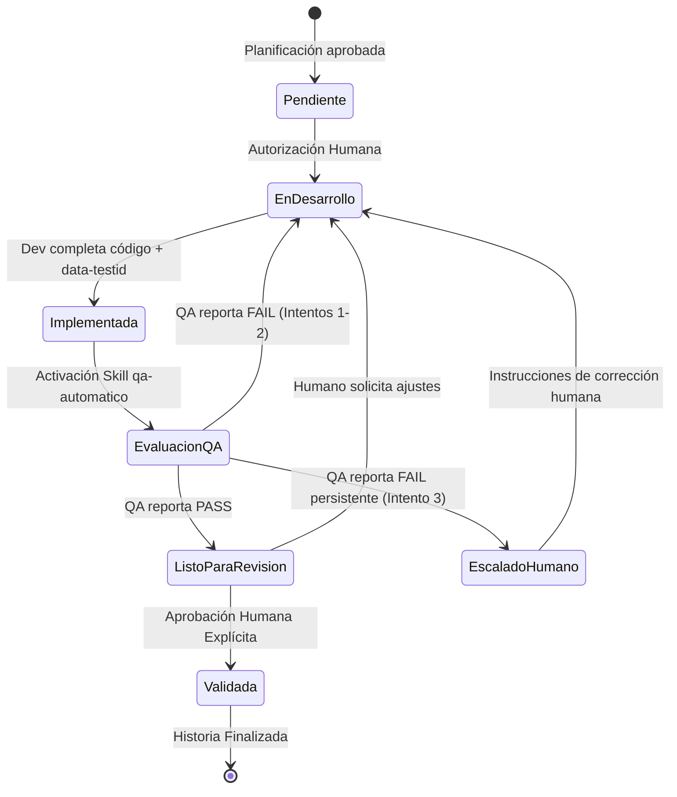

# Tablero de Seguimiento de Historias de Usuario

> **Proyecto**: Mi Negocio Digital  
> **Artefacto**: 3 de 3 (Seguimiento Centralizado del Desarrollo y QA)  
> **Estado General**: Listo para Inicio de Desarrollo y QA Automático  
> **Última Actualización**: Noviembre 2026  

Este tablero constituye la única fuente centralizada de verdad operativa para el ciclo de vida de desarrollo, ejecución de pruebas automáticas y validación humana de **Mi Negocio Digital**.

---

## 1. Métricas de Progreso Global

| Métrica | Valor | Porcentaje |
| :--- | :---: | :---: |
| **Historias Totales del MVP** | 8 | 100% |
| **Historias Validadas (Aprobadas por Humano)** | 8 (HU-01 a HU-08) | 100.0% |
| **Historias en Desarrollo / Implementadas** | 0 | 0.0% |
| **Historias Pendientes** | 0 | 0.0% |
| **Pruebas Funcionales Automatizadas en PASS** | 20 / 20 casos | 100.0% |
| **Avance Global del Proyecto** | **100.0% Validado por Humano** |  |

---

## 2. Tablero Centralizado de Historias (8 HU)

| Historia de Usuario | Módulo / Prioridad | Estado del Desarrollo | Pruebas Funcionales | Resultado PASS/FAIL | Aprobación Humana |
| :--- | :--- | :---: | :--- | :---: | :---: |
| **HU-01: Configuración de Datos y Horarios** | Configuración `Must have` | `Validada` | `TC-HU01-01` `TC-HU01-02` (2/2) | `PASS` | `Aprobada por Humano` |
| **HU-02: Catálogo de Servicios** | Servicios `Must have` | `Validada` | `TC-HU02-01` `TC-HU02-02` `TC-HU02-03` `TC-HU02-04` `TC-HU02-05` (5/5) | `PASS` | `Aprobada por Humano` *(Edición y eliminación pendientes de revisión manual)* |
| **HU-03: Directorio de Clientes** | Clientes `Must have` | `Validada` | `TC-HU03-01` `TC-HU03-02` (2/2) | `PASS` | `Aprobada por Humano` |
| **HU-04: Agendamiento y Anticolisión** | Citas / Agenda `Must have` | `Validada` | `TC-HU04-01` `TC-HU04-02` `TC-HU04-03` `TC-HU04-04` (4/4) | `PASS` | `Aprobada por Humano` |
| **HU-05: Visualización y Filtros de Agenda** | Citas / Agenda `Must have` | `Validada` | `TC-HU05-01` `TC-HU05-02` (2/2) | `PASS` | `Aprobada por Humano` |
| **HU-06: Ciclo de Vida de Citas** | Citas / Agenda `Must have` | `Validada` | `TC-HU06-01` `TC-HU06-02` `TC-HU06-03` (3/3) | `PASS` | `Aprobada por Humano` *(Integración de gestión pendiente de revisión manual)* |
| **HU-07: Reprogramación con Validación** | Citas / Agenda `Should have` | `Validada` | `TC-HU07-01` (1/1) | `PASS` | `Aprobada por Humano` |
| **HU-08: Dashboard Operativo Diario** | Panel Principal `Should have` | `Validada` | `TC-HU08-01` (1/1) | `PASS` | `Aprobada por Humano` |

---

## 3. Matriz de Estados y Responsabilidades

| Transición de Estado | Actor Responsable | Condición Previa | Acción en Tablero |
| :--- | :--- | :--- | :--- |
| **Pendiente → En desarrollo** | Desarrollador de Historias | El usuario humano autoriza el inicio en el chat. | Cambiar *Estado del Desarrollo* a `En desarrollo`. |
| **En desarrollo → Implementada** | Desarrollador de Historias | Código completado con selectores `data-testid` y compilación limpia. | Cambiar *Estado del Desarrollo* a `Implementada`. |
| **Implementada → PASS / FAIL** | QA Automático | Ejecución de la suite Playwright mapeada en `relaciones-historias-pruebas.md`. | Asignar `PASS` o `FAIL` en *Resultado PASS/FAIL*. |
| **FAIL → En desarrollo** | Desarrollador de Historias | Notificación de fallo por parte de QA (hasta 3 intentos acotados a la HU). | Revertir *Estado del Desarrollo* a `En desarrollo` para corregir. |
| **FAIL Persistente (3er intento)** | QA Automático / Humano | El fallo no se resuelve tras 3 ciclos de corrección. | Conservar `FAIL`, detener ciclo automático y solicitar intervención humana. |
| **PASS → Validada** | **Usuario Humano** | Revisión de criterios comprobados y visto bueno en el chat. | Cambiar *Estado del Desarrollo* a `Validada` y *Aprobación Humana* a `Aprobada por Humano`. |

---

## 4. Bitácora de Eventos del Proyecto

| Fecha / Timestamp | Historia | Actor | Evento / Acción Realizada |
| :--- | :---: | :---: | :--- |
| 2026-11-21 | General | Sistema | Inicialización del tablero con las 8 Historias de Usuario aprobadas en estado `Pendiente`. |
| 2026-11-21 | General | QA Automático | Creación de Skill qa-automatico, configuración de Playwright y preparación del entorno de pruebas aislado SQLite. |
| 2026-11-21 | HU-01 | Desarrollador | Implementación completa de vista /horarios, Server Actions y selectores data-testid en Next.js y SQLite. Estado: Implementada. |
| 2026-11-21 | HU-01 | QA Automático | Ejecución visible en Chromium (slowMo: 500ms) de TC-HU01-01 y TC-HU01-02 sobre test.db. Resultado: PASS (2/2). Pendiente visto bueno humano. |
| 2026-11-21 | HU-01 | Usuario Humano | Aprobación formal confirmada en chat tras comprobación visual en Chromium. Estado: Validada (100% completada). |
| 2026-11-21 | General | QA Automático | Configuración de servidor de test independiente en localhost:3001 (test.db) y preparación de ejecutor visual multi-historia ejecutar-pruebas-visual.bat. |
| 2026-11-21 | HU-02 | Desarrollador | Implementación completa de /servicios, modal, Server Actions y selectores data-testid. Estado: Implementada. |
| 2026-11-21 | HU-02 | QA Automático | Ejecución visible en Chromium (slowMo: 1000ms) de TC-HU02-01 y TC-HU02-02 sobre test.db en puerto 3001. Resultado: PASS (2/2). Pendiente visto bueno humano. |
| 2026-11-21 | HU-02 | Usuario Humano | Aprobación formal confirmada en chat tras comprobación visual en Chromium. Estado: Validada (100% completada). |
| 2026-11-21 | HU-03 | Desarrollador | Inicio autorizado del desarrollo de HU-03: Registro y Directorio de Clientes. Estado: En desarrollo. |
| 2026-11-21 | HU-03 | Desarrollador | Implementación completa de /clientes, modal, Server Actions, validaciones Zod y selectores data-testid. Compilación limpia (npm run build). Estado: Implementada. |
| 2026-11-21 | HU-03 | QA Automático | Ejecución visible en Chromium (slowMo: 1000ms) de TC-HU03-01 y TC-HU03-02 sobre test.db en puerto 3001. Resultado: PASS (2/2). Pendiente visto bueno humano. |
| 2026-11-21 | HU-03 | Usuario Humano | Aprobación formal confirmada en chat tras comprobación visual en Chromium. Estado: Validada (100% completada). |
| 2026-11-21 | HU-04 | Desarrollador | Inicio autorizado del desarrollo de HU-04: Agendamiento de Citas con Prevención de Solapamientos. Estado: En desarrollo. |
| 2026-11-21 | HU-04 | Desarrollador | Implementación completa de /citas, modal de agendamiento, Server Actions, validación anti-solapamiento y selectores data-testid. Compilación limpia (npm run build). Estado: Implementada. |
| 2026-11-21 | HU-04 | QA Automático | Ejecución visible en Chromium (slowMo: 1000ms) de TC-HU04-01 a TC-HU04-04 sobre test.db en puerto 3001. Ciclo de corrección 1. Resultado: PASS (4/4). Pendiente visto bueno humano. |
| 2026-11-21 | HU-04 | Usuario Humano | Aprobación formal confirmada en chat tras comprobación visual en Chromium. Estado: Validada (100% completada). |
| 2026-11-21 | HU-05 | Desarrollador | Inicio autorizado del desarrollo de HU-05: Visualización y Filtrado de la Agenda de Citas. Estado: En desarrollo. |
| 2026-11-21 | HU-05 | Desarrollador | Implementación de navegación cronológica por fechas (btn-next-day, btn-prev-day, header-agenda-date) y filtros por estado (filter-status-confirmed, badges de estado). Compilación limpia (npm run build). Estado: Implementada. |
| 2026-11-21 | HU-05 | QA Automático | Ejecución visible en Chromium (slowMo: 1000ms) de TC-HU05-01 y TC-HU05-02 sobre test.db en puerto 3001. Resultado: PASS (2/2). Pendiente visto bueno humano. |
| 2026-11-21 | HU-05 | Usuario Humano | Aprobación formal confirmada en chat tras comprobación visual en Chromium. Estado: Validada (100% completada). |
| 2026-11-21 | HU-06 | Desarrollador | Inicio autorizado del desarrollo de HU-06: Gestión del Ciclo de Vida de las Citas. Estado: En desarrollo. |
| 2026-11-21 | HU-06 | Desarrollador | Implementación de transiciones de estado (btn-status-completed, btn-cancel-appointment, modal de confirmación con btn-confirm-cancel, badges completada y cancelada) y liberación automática de cupos en SQLite. Compilación limpia (npm run build). Estado: Implementada. |
| 2026-11-21 | HU-06 | QA Automático | Ejecución visible en Chromium de TC-HU06-01 y TC-HU06-02 sobre test.db en puerto 3001. Resultado: PASS (2/2). Pendiente visto bueno humano. |
| 2026-11-21 | HU-06 | Usuario Humano | Aprobación formal confirmada en chat tras comprobación visual en Chromium. Estado: Validada (100% completada). |
| 2026-11-21 | HU-07 | Desarrollador | Inicio autorizado del desarrollo de HU-07: Reprogramación de Citas con Revalidación Horaria. Estado: En desarrollo. |
| 2026-11-21 | HU-07 | Desarrollador | Implementación de Server Action rescheduleAppointment, validación Zod RescheduleSchema, modal con btn-reschedule, input-reschedule-time, input-reschedule-date, validación en tiempo real y toast-reschedule-success. Compilación limpia (npm run build). Estado: Implementada. |
| 2026-11-21 | HU-07 | QA Automático | Ejecución visible en Chromium de TC-HU07-01 sobre test.db en puerto 3001. Resultado: PASS (1/1). Pendiente visto bueno humano. |
| 2026-11-21 | HU-07 | Usuario Humano | Aprobación formal confirmada en chat tras comprobación visual en Chromium. Estado: Validada (100% completada). |
| 2026-11-21 | HU-08 | Desarrollador | Inicio autorizado del desarrollo de HU-08: Dashboard Operativo Diario y Accesos Rápidos. Estado: En desarrollo. |
| 2026-11-21 | HU-08 | Desarrollador | Implementación completa de vista /dashboard, Server Action getDashboardData, tarjetas de métricas (metric-today-appointments, metric-pending-appointments), lista cronológica (dashboard-appointments-list) y accesos rápidos. Compilación limpia (npm run build). Estado: Implementada. |
| 2026-11-21 | HU-08 | QA Automático | Ejecución visible en Chromium de TC-HU08-01 sobre test.db en puerto 3001. Resultado: PASS (1/1). Pendiente visto bueno humano. |
| 2026-11-21 | HU-08 | Usuario Humano | Aprobación formal confirmada en chat tras comprobación visual en Chromium. Estado: Validada (100% completada). El MVP queda formalmente finalizado con las 8 historias validadas. |
| 2026-11-21 | HU-02 | Desarrollador / QA | Ampliación autorizada para edición de servicios: implementación de Server Action updateService, botón data-testid="btn-edit-service", modal interactivo de edición con datos precargados y nuevo caso Playwright TC-HU02-03. Verificación Playwright 3/3 en PASS. Estado: Validada (ampliación de edición pendiente de revisión manual del usuario). |
| 2026-11-21 | HU-02 | Desarrollador / QA | Ampliación autorizada para eliminación de servicios: implementación de Server Action deleteService con validación Zod y bloqueo de eliminación si tiene citas vinculadas, botón data-testid="btn-delete-service", modal data-testid="modal-delete-confirmation" y casos TC-HU02-04 y TC-HU02-05. Verificación Playwright 5/5 en PASS. Estado: Validada (ampliación de edición y eliminación pendiente de revisión manual del usuario). |
| 2026-11-22 | HU-06 / HU-07 | Desarrollador / QA | Integración completa de gestión de citas en /citas: incorporación de botón data-testid="btn-manage-appointment", modal interactivo data-testid="modal-manage-appointment", confirmación de citas pendientes (data-testid="btn-status-confirmed"), validación en servidor de protección de citas completadas y canceladas, y nuevo caso Playwright TC-HU06-03. Regresión HU-04 a HU-07 (10/10) en PASS. Estado: Validada (integración de gestión pendiente de revisión manual del usuario). |
